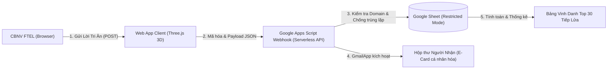

# ĐỀ XUẤT GIẢI PHÁP & THIẾT KẾ WEB APP "THẮP LỬA TRI ÂN"
## CHÀO MỪNG NGÀY NHÀ GIÁO VIỆT NAM – FPT TELECOM 20/11/2026

> **Chủ đề chiến dịch:** "Gửi lời cảm ơn – Thắp sáng tri thức"  
> **Đơn vị thực hiện:** FPT Telecom  
> **Thời hạn hoàn thiện & kiểm thử:** Trước ngày 01/11/2026  
> **Mục tiêu chính:** Thay thế Google Form bằng Web App 3D mượt mà, cảm xúc, tăng tính bảo mật, tự động tạo thiệp E-Card và tổng hợp xét giải *"30 Tiếp lửa bền bỉ"*.

---

## 1. SO SÁNH & ĐÁNH GIÁ 2 PHƯƠNG ÁN XÁC THỰC EMAIL FTEL

Để trả lời trăn trở của bạn về việc lựa chọn giữa **"Gửi OTP qua email"** và **"Chỉ cần nhập mail FPT vào ô đăng nhập"**, dưới đây là bảng phân tích chuyên sâu:

| Tiêu chí | Phương án A: Chỉ nhập Email FPT (`@fpt.net` / `@fpt.com`) | Phương án B: Gửi OTP xác thực qua Email | Phương án C Đề xuất: **Hybrid (Xác thực thông minh)** |
| :--- | :--- | :--- | :--- |
| **Trải nghiệm CBNV (UX)** | ⭐⭐⭐⭐⭐ **Cực kỳ mượt mà**, hoàn thành gửi lời cảm ơn chỉ trong 60 giây. | ⭐⭐⭐ **Tạo ma sát (Friction)**: Phải chuyển tab vào mail lấy OTP, dễ bỏ dở giữa chừng nếu mail OTP bị delay. | ⭐⭐⭐⭐⭐ **Tối ưu**: Nhập email FPT + Mã Nhân Viên (MNV) hoặc 1-Click Google SSO FPT. |
| **Tính bảo mật & Chống mạo danh** | ⭐⭐⭐ Có thể có rủi ro người khác gõ nhầm hoặc cố tình mượn email đồng nghiệp để gửi lời chúc. | ⭐⭐⭐⭐⭐ **Bảo mật tuyệt đối**: Chỉ người sở hữu hộp thư mới nhận được mã OTP để gửi. | ⭐⭐⭐⭐+ **Bảo mật cao**: MNV là thông tin nội bộ của từng CBNV, triệt tiêu nguy cơ mạo danh mà không tốn công chờ OTP. |
| **Rủi ro kỹ thuật & Quá tải** | ⭐⭐⭐⭐⭐ **0% rủi ro nghẽn**: Không tiêu tốn hạn ngạch gửi email OTP. | ⚠️ **Rủi ro hạn ngạch**: Google Apps Script giới hạn gửi 1,500 mail/ngày. Nếu hàng ngàn CBNV cùng gửi và nhận OTP, có thể chạm trần gửi mail của hòm thư BTC! | ⭐⭐⭐⭐⭐ **Tiết kiệm quota**: Toàn bộ hạn ngạch email của hệ thống được dồn để gửi E-Card cho người nhận! |

### 👉 Khuyến nghị từ chuyên gia:
- **Lựa chọn tối ưu nhất cho chiến dịch 20/11:** Sử dụng **Phương án Hybrid (Email FTEL + Mã nhân viên hoặc Tự động lưu phiên)**:
  1. Người gửi nhập Email `@fpt.net` / `@fpt.com` và Mã Nhân Viên (tùy chọn hoặc bắt buộc nhẹ).
  2. Hệ thống kiểm tra hợp lệ đuôi email ngay tại trình duyệt và backend.
  3. Khi gửi thành công, người gửi cũng nhận được 1 email xác nhận/lưu thiệp (CC mail). Nếu có trường hợp mạo danh, người bị mạo danh sẽ biết ngay lập tức qua hòm thư của mình.

---

## 2. KIẾN TRÚC BẢO MẬT DỮ LIỆU GOOGLE SHEETS (RESTRICTED MODE)

### Mô hình luồng dữ liệu (Data Flow Architecture)

### Các tầng bảo mật cam kết:
1. **Google Sheet hoàn toàn đặt chế độ Hạn chế (Restricted):**
   - Chỉ duy nhất tài khoản BTC/Admin triển khai hệ thống có quyền xem và chỉnh sửa file Sheet.
   - CBNV bình thường **hoàn toàn không có đường link và không được cấp quyền** truy cập trang tính.
2. **Nguyên lý Write-Only (Chỉ ghi, không đọc chéo):**
   - Web App chạy dưới quyền `Execute as: Me` (Tài khoản BTC).
   - API không mở bất kỳ endpoint nào cho phép người gửi xem danh sách lời cảm ơn của các CBNV khác.
3. **Chống tấn công & Chống gửi lặp (Anti-Spam & Deduplication):**
   - **Tần suất gửi:** Giới hạn tối thiểu 15-30 giây giữa 2 lượt gửi từ cùng một trình duyệt/người gửi.
   - **Chống trùng nội dung:** Backend tự động quét và chặn nếu phát hiện cùng một người gửi gửi lời chúc có nội dung tương tự cho cùng một người nhận trong thời gian ngắn.

---

## 3. Ý TƯỞNG THIẾT KẾ VISUAL 3D: "MƯỢT MÀ VÀ Ý NGHĨA"

Thay vì giao diện phẳng đơn điệu của Google Form, Web App mang lại trải nghiệm cảm xúc độc đáo qua công nghệ **Three.js & WebGL**:

### A. Hình tượng chủ đạo: "Trái Tim Tri Thức & Ngọn Đuốc FPT"
- **Khối Pha Lê Tri Thức (Crystal Knowledge Core):** Ở trung tâm không gian 3D là một khối đa diện pha lê phát sáng, tượng trưng cho nền tảng tri thức vững chãi của FPT Telecom.
- **3 Vòng Quỹ Đạo Vàng (Celestial Orbit Rings):** Đại diện cho 3 giá trị cốt lõi: *Tôn trọng - Đổi mới - Đồng đội*, không ngừng chuyển động nhịp nhàng quanh ngọn lửa.
- **Dải Hạt Sáng Thăng Hoa (Sparks & Stardust):** Hàng trăm hạt sáng vàng cam bay lượn từ dưới lên trên, tượng trưng cho những đóng góp và lời cảm ơn của hàng ngàn CBNV đang hội tụ.

### B. Tương tác mượt mà theo cử chỉ (Interactive Dynamics):
1. **Theo dõi chuột/chạm cảm ứng:** Ngọn lửa và góc chiếu sáng 3D chuyển động mượt mà (smooth lerp) theo hướng rê chuột của người dùng trên máy tính hoặc vuốt ngón tay trên điện thoại.
2. **Phản hồi theo nhịp gõ phím:** Khi người dùng bắt đầu gõ lời cảm ơn vào khung nhập liệu, ngọn lửa 3D sẽ chuyển sang chế độ "Thắp sáng nhịp đập" (pulsing flame), tạo cảm giác sống động như tri thức đang được truyền vào từng con chữ.
3. **Hiệu ứng Bùng Nổ "Thắp Lửa" (Supernova Ignite Effect):** Khi bấm nút *"Thắp Lửa Tri Ân"*, ngọn lửa 3D sẽ co lại tích tụ năng lượng rồi bùng nổ một đợt sóng ánh sáng 360 độ (shockwave), phóng các tia sáng rực rỡ lên không trung kết hợp cùng pháo hoa Confetti chúc mừng!
4. **Hiệu ứng Thiệp 3D (Perspective Tilt):** Thiệp E-Card xem trước tự động xoay góc nhìn 3D khi rê chuột, phản chiếu ánh sáng chân thực như cầm một tấm thiệp vàng sang trọng trên tay.

---

## 4. TỰ ĐỘNG HÓA E-CARD & HỆ THỐNG GỬI EMAIL THÔNG BÁO

1. **Sinh E-Card tự động (High-Resolution Canvas Engine):**
   - Kích thước chuẩn: `1080 x 1440 px` (sắc nét, sẵn sàng để người nhận tải về hoặc chia sẻ lên Facebook/Workplace).
   - Tích hợp nhận diện thương hiệu FTEL: Logo, thông điệp chiến dịch 20/11/2026, tên người nhận, chức danh/vai trò, lời chúc, tên người gửi và đơn vị.
   - Hỗ trợ 3 phong cách thiết kế sang trọng:
     - **Hoàng Kim Tri Ân:** Xanh Navy hoàng gia kết hợp hoa văn chỉ vàng.
     - **Ngọn Lửa Bền Bỉ:** Tone màu cam FPT rực cháy nhiệt huyết.
     - **Tương Lai Tri Thức:** Tone màu Cyan công nghệ hiện đại.
2. **Kích hoạt gửi Email tự động:**
   - Ngay khi dữ liệu được ghi vào Sheet, Google Apps Script sẽ dùng `GmailApp` để gửi thư tới người nhận.
   - Thư được trình bày theo định dạng **HTML Email cao cấp**, nhúng sẵn ảnh thiệp E-Card hoặc đính kèm tệp PNG chất lượng cao.
   - Ghi lại trạng thái gửi email (`SENT_SUCCESS` hoặc `FAILED`) và thời gian gửi vào cột L, M trên Google Sheet để BTC dễ dàng theo dõi.

---

## 5. BẢNG VINH DANH "30 TIẾP LỬA BỀN BỈ" & DASHBOARD TRUYỀN THÔNG

- **Bảng Vàng Thời Gian Thực (Live Leaderboard):**
  - Tự động thống kê số lượt tri ân nhận được của từng Mentor/Coach/Giảng viên.
  - Xếp hạng Top 30 cán bộ có số lượt cảm ơn nhiều nhất.
  - Trao huy hiệu danh dự: 🥇 Top 1 (Vàng), 🥈 Top 2 (Bạc), 🥉 Top 3 (Đồng).
- **Bộ lọc & Công cụ dành cho Ban Truyền Thông (BTC):**
  - Thanh tìm kiếm theo Họ tên, Email, Đơn vị.
  - Lọc theo từng khối/chi nhánh (TIN, PNC, FTI, NOC, CS, Trung tâm Đào tạo...).
  - Nút **"Xuất Báo Cáo Excel (.CSV)"** chuẩn UTF-8 có dấu chỉ với 1 click chuột, giúp BTC có ngay dữ liệu để thiết kế ấn phẩm truyền thông hoặc công bố giải thưởng.

---

## 6. KẾ HOẠCH TRIỂN KHAI & KIỂM THỬ (DEADLINE TRƯỚC 01/11/2026)

| Giai đoạn | Thời gian | Hạng mục công việc chính | Kết quả đầu ra |
| :--- | :--- | :--- | :--- |
| **Giai đoạn 1** | 20/10 - 23/10 | - Hoàn thiện giao diện Web App 3D & E-Card Engine. - Triển khai Google Apps Script kết nối Google Sheet Restricted. - Thiết lập mẫu email HTML thương hiệu FTEL. | Bản Web App chạy trên môi trường test nội bộ BTC. |
| **Giai đoạn 2** | 24/10 - 27/10 | - Kiểm thử tải đồng thời (Load Test & Concurrency Control). - Kiểm thử gửi email thực tế đến các hòm thư `@fpt.net` và `@fpt.com`. - Kiểm thử tính chính xác của thuật toán xếp hạng Top 30. | Báo cáo kiểm thử đạt chuẩn an toàn & không nghẽn mail. |
| **Giai đoạn 3** | 28/10 - 31/10 | - Gửi thử nghiệm UAT cho nhóm 50 CBNV đại diện. - Tinh chỉnh giao diện mobile tối ưu cho màn hình điện thoại. - Hoàn tất cấu hình tên miền chính thức hoặc link nội bộ. | Hệ thống sẵn sàng 100% trước mốc 01/11/2026. |
| **Giai đoạn 4** | 01/11 - 20/11 | - Chính thức truyền thông phát động toàn công ty. - BTC theo dõi Dashboard, trích xuất dữ liệu xét giải "30 Tiếp lửa bền bỉ". | Trao giải và tổng kết chiến dịch 20/11. |
